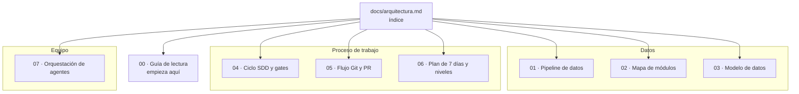

# Arquitectura y proceso del proyecto EDA

> Mapa visual del proyecto: cómo fluyen los datos, cómo se organiza el código,
> cómo se planifica el trabajo y cómo se integra en Git.
>
> Este documento es el **índice**. Cada parte tiene su propio fichero en
> `docs/arquitectura/` para poder leerla al detalle sin cargar todo el mapa.
>
> Es documentación **derivada**: si hay contradicción, mandan `AGENTS.md`,
> `openspec/` y los issues.

## Cómo navegar

## Documentos

| Documento | Qué responde | Cuándo leerlo |
|---|---|---|
| [00 · Guía de lectura](arquitectura/00_guia_lectura.md) | ¿Por dónde empiezo y qué significa cada término? | Si es tu primera vez en el proyecto o en EDA |
| [01 · Pipeline de datos](arquitectura/01_pipeline_datos.md) | ¿Qué recorre el dato desde el CSV hasta el informe? | Antes de tocar `load`, `clean` o el pipeline |
| [02 · Mapa de módulos](arquitectura/02_mapa_modulos.md) | ¿Dónde vive cada responsabilidad y quién llama a quién? | Antes de añadir código o importar entre módulos |
| [03 · Modelo de datos](arquitectura/03_modelo_datos.md) | ¿Qué capas, claves, tipos y reglas tiene el dataset? | Antes de limpiar, agregar o hacer merge |
| [04 · Ciclo SDD y gates](arquitectura/04_ciclo_sdd.md) | ¿Qué hace falta para pasar de issue a código? | Antes de escribir una spec, un design o una tarea |
| [05 · Flujo Git y PR](arquitectura/05_flujo_git_pr.md) | ¿Cómo llega una rama a `develop` y a `main`? | Antes de abrir una rama o una PR |
| [06 · Plan de 7 días](arquitectura/06_plan_7_dias.md) | ¿Qué se hace cada día y qué se entrega? | Al planificar la semana o revisar el avance |
| [07 · Orquestación de agentes](arquitectura/07_orquestacion_agentes.md) | ¿Qué subagente hace cada cosa y con qué límites? | Antes de delegar una tarea a un subagente |

## Estado actual

| Área | Estado |
|---|---|
| Ingesta (`load.py`) | Implementado |
| Limpieza básica (`clean.py`) | Implementado |
| Features, notebooks, informe y pipeline | Planificado (N2/N3) |

Los detalles de qué está hecho y qué falta viven en cada documento y en
`openspec/changes/<change>/tasks.md`. Este índice no sustituye al tablero.

## Fuentes de verdad

1. `AGENTS.md`: reglas del proyecto.
2. `openspec/config.yaml` y `openspec/specs/`: qué debe hacer el sistema.
3. `openspec/changes/<change>/`: propuesta, diseño y tareas en curso.
4. Issues y milestones de GitHub: qué se está ejecutando y en qué nivel.
5. `docs/contexto_proyecto_eda.md` y `README.md`: contexto y enunciado.

## Mantenimiento

| Si cambia… | Actualiza… |
|---|---|
| Un módulo o una responsabilidad | [02 · Mapa de módulos](arquitectura/02_mapa_modulos.md) |
| Una etapa del pipeline | [01 · Pipeline de datos](arquitectura/01_pipeline_datos.md) |
| Una capa, clave o regla del dataset | [03 · Modelo de datos](arquitectura/03_modelo_datos.md) |
| Un gate o un estado de tarea | [04 · Ciclo SDD](arquitectura/04_ciclo_sdd.md) |
| Ramas, commits o CI | [05 · Flujo Git y PR](arquitectura/05_flujo_git_pr.md) |
| El reparto de días o niveles | [06 · Plan de 7 días](arquitectura/06_plan_7_dias.md) |
| Un subagente o sus permisos | [07 · Orquestación de agentes](arquitectura/07_orquestacion_agentes.md) |

Si el cambio es estructural, actualiza primero `AGENTS.md` y `openspec/`, y
después este mapa.
