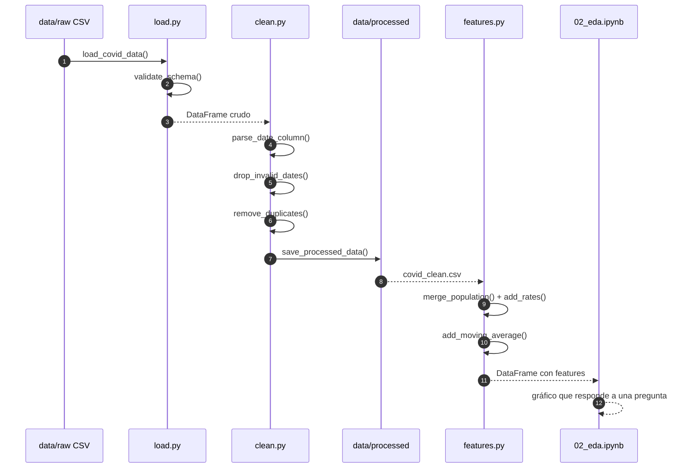
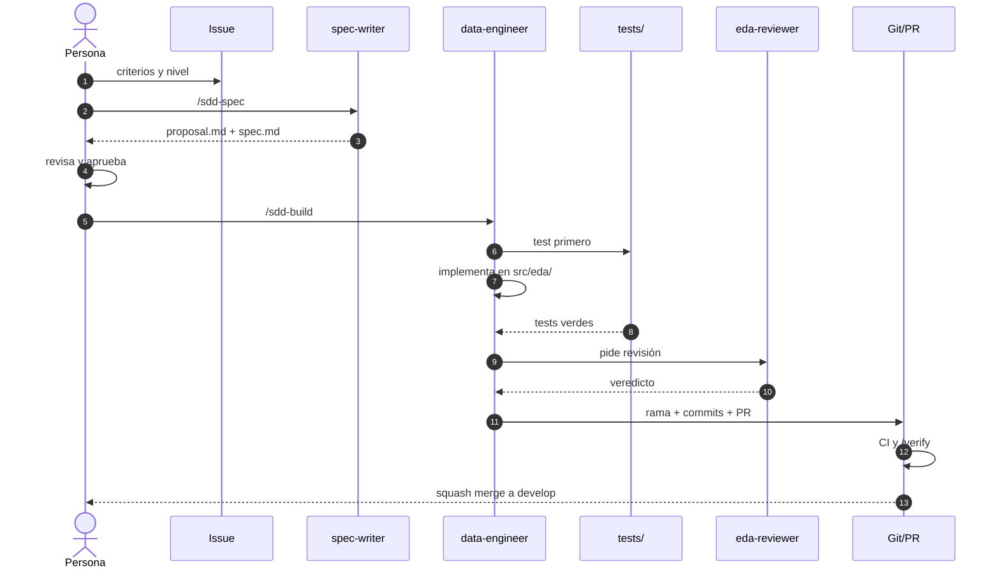

# 00 · Guía de lectura

[← Volver al índice](../arquitectura.md)

## Para quién es esta guía

Sabes programar, pero es tu primer EDA y quizá también tu primer proyecto con
specs, ramas y PRs. Esta guía traduce la jerga y propone un orden para leer el
mapa sin perderte. No explica qué es un bucle: explica cómo se piensa un
análisis de datos y cómo se organiza el trabajo.

## Qué vas a aprender

1. Leer un dataset real y detectar qué está sucio.
2. Justificar cada decisión de limpieza con una auditoría.
3. Construir features que permitan comparar de forma justa.
4. Contar una historia con figuras y un informe para alguien no técnico.
5. Trabajar con issues, specs, ramas, tests y PRs sin saltarte pasos.

## Cómo leer este mapa

| Orden | Documento | Qué te llevas |
|---|---|---|
| 1 | [01 · Pipeline de datos](01_pipeline_datos.md) | El recorrido completo del dato y sus controles |
| 2 | [02 · Mapa de módulos](02_mapa_modulos.md) | Dónde vive cada responsabilidad |
| 3 | [03 · Modelo de datos](03_modelo_datos.md) | Qué significa una fila, una clave y una regla |
| 4 | [04 · Ciclo SDD](04_ciclo_sdd.md) | Cómo se pasa de un issue a código |
| 5 | [05 · Flujo Git y PR](05_flujo_git_pr.md) | Cómo se integra el trabajo |
| 6 | [06 · Plan de 7 días](06_plan_7_dias.md) | Qué toca cada día |
| 7 | [07 · Orquestación de agentes](07_orquestacion_agentes.md) | Quién hace cada tarea |

> Si es tu primera vez, **no empieces por el 07**. El mapa de agentes explica
> cómo se produce el trabajo, no cómo se analizan los datos.

## Glosario

### Datos

| Término | Qué significa | Ejemplo en el proyecto |
|---|---|---|
| **EDA** | Análisis Exploratorio de Datos: resumir, visualizar y buscar patrones o anomalías antes de modelar | Perfilar el CSV, mirar nulos y dibujar distribuciones |
| **Dataset** | Conjunto de datos tabular | El CSV del COVID Tracking Project |
| **Fila / registro** | Una observación | Un estado en un día concreto |
| **Columna / variable** | Una característica medida | `positive`, `death`, `state` |
| **dtype** | Tipo de dato de una columna | `date` pasa de entero a `datetime64[ns]` |
| **Nulo** | Valor ausente | `NaN` en una columna casi vacía |
| **Duplicado** | Dos filas con la misma clave | Dos registros con el mismo `(state, date)` |
| **Outlier** | Valor atípico frente al resto | Un incremento diario imposiblemente alto |
| **Acumulado** | Total desde el inicio | `positive` |
| **Incremento** | Cambio diario | `positiveIncrease` |

### Transformación

| Término | Qué significa | Ejemplo en el proyecto |
|---|---|---|
| **Clave** | Columna(s) que identifican una fila | `(state, date)` |
| **Merge** | Cruzar dos tablas por una clave | Unir casos con población por estado |
| **Ratio por 100k** | Normalizar por población | `positive / population * 100_000` |
| **Media móvil** | Suavizar una serie con una ventana | Media de 7 días de `positiveIncrease` |
| **`raw`** | Dato original, inmutable | `data/raw/covid_tracking_states_daily.csv` |
| **`processed`** | Dato limpio, generado por código | `data/processed/covid_clean.csv` |

### Proceso

| Término | Qué significa | Ejemplo en el proyecto |
|---|---|---|
| **Issue** | Tarea con criterios de aceptación | `#5` limpieza básica |
| **Change** | Carpeta de OpenSpec con proposal, specs, design y tasks | `openspec/changes/add-limpieza-calidad/` |
| **Spec** | Requisitos verificables (`SHALL`, `WHEN/THEN`) | “El sistema SHALL convertir `date` a datetime” |
| **Design** | Cómo se implementa la spec | Decisiones y riesgos del change |
| **Gate** | Condición obligatoria para avanzar | “No hay código sin `tasks.md`” |
| **Milestone** | Agrupación por nivel | `N1 · Esencial` |
| **N1/N2/N3** | Niveles de entrega | Esencial, Medio, Avanzado |
| **PR** | Pull Request: propuesta de cambio | Rama `feat/5-limpieza` → `develop` |
| **Squash merge** | Unir una rama en un solo commit | Un issue deja un commit limpio |
| **CI** | Comprobaciones automáticas | `ruff`, `pytest`, `spec:validate` |

## Leyenda de los diagramas

| Elemento | Significado |
|---|---|
| Rectángulo | Etapa, fichero o artefacto |
| Rombo | Decisión con dos caminos |
| Flecha continua | Flujo de datos o de trabajo |
| Flecha discontinua | Test o dependencia indirecta |
| Amarillo | Datos de entrada |
| Azul | Proceso o lógica |
| Verde | Salida o artefacto entregable |
| Morado | Control, validación o test |
| Gris discontinuo | Todavía no existe: está planificado |

## Recorrido de un dato

Este diagrama sigue una fila desde el CSV hasta el gráfico. Es la vista
“horizontal” del proyecto: qué le pasa al dato en cada módulo.



**Qué mirar**

- `load.py` no limpia: solo descarga, lee y valida.
- `clean.py` no calcula features: solo fechas, duplicados y auditoría.
- `features.py` no dibuja: prepara ratios, media móvil y segmentos.
- El notebook no transforma: llama y muestra.

**Qué puede fallar**

| Punto | Fallo típico |
|---|---|
| `load.py` | URL caída, CSV vacío o esquema incompleto |
| `clean.py` | Fecha imposible, duplicado sin `dateModified` |
| `features.py` | Merge que pierde estados o duplica filas |
| Notebook | Estado oculto, ruta absoluta, output versionado |

## Recorrido de una tarea

Este diagrama sigue un issue desde que se define hasta que entra en `develop`.
Es la vista “vertical”: cómo se produce el trabajo.



**Qué mirar**

- La persona aprueba el `proposal` y la spec; el agente no se autoaprueba.
- El test se escribe antes de la implementación cuando es posible.
- `eda-reviewer` solo lee: no arregla el trabajo que revisa.
- La PR no se mergea si la CI o `/verify` están en rojo.

## Ruta según objetivo

| Quiero… | Leo… |
|---|---|
| Entender el dataset y sus problemas | [03](03_modelo_datos.md) y [01](01_pipeline_datos.md) |
| Escribir código sin duplicar lógica | [02](02_mapa_modulos.md) |
| Planificar una tarea | [04](04_ciclo_sdd.md) |
| Abrir una rama o una PR | [05](05_flujo_git_pr.md) |
| Saber qué toca esta semana | [06](06_plan_7_dias.md) |
| Delegar en un subagente | [07](07_orquestacion_agentes.md) |

## Primer ejercicio

Ejercicio de 10 minutos para perderle el miedo al dataset. No limpies nada
todavía: solo mira y anota.

```python
from src.eda.load import load_covid_data
from src.eda.clean import clean_covid_data, audit_cleaning

raw = load_covid_data()
clean = clean_covid_data(raw)

print("shape raw:", raw.shape)
print("shape clean:", clean.shape)
print(audit_cleaning(raw, clean))
```

Responde por escrito:

1. ¿Qué columna tiene más nulos?
2. ¿Cuántos duplicados `(state, date)` había?
3. ¿Qué limpiarías después y por qué?

Si no sabes responder, no pasa nada: las respuestas están en
[03 · Modelo de datos](03_modelo_datos.md) y en `docs/data_dictionary.md`.

## Después de la guía

1. Lee el [01 · Pipeline](01_pipeline_datos.md) y sigue una fila mentalmente.
2. Abre `src/eda/load.py` y `src/eda/clean.py`: son cortos.
3. Ejecuta los tests: `python -m pytest -q`.
4. Mira el [06 · Plan](06_plan_7_dias.md) y elige la primera tarea que te toque.
