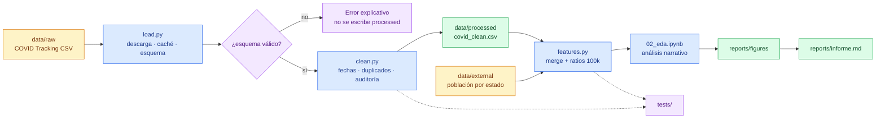

# 01 · Pipeline de datos

[← Volver al índice](../arquitectura.md)

> **En una frase:** el dato recorre cuatro capas hasta convertirse en una
> conclusión, y cada salto tiene un control.
>
> ¿Es tu primera vez? Lee antes la [guía de lectura](00_guia_lectura.md).

## Para qué sirve

Este documento describe el recorrido completo del dato: desde el CSV original
del COVID Tracking Project hasta el informe ejecutivo. Sirve para saber qué
etapa toca cada fichero, qué se valida en cada paso y dónde puede romperse.

## Diagrama



## Etapas

| # | Etapa | Entrada | Proceso | Salida | Control |
|---|---|---|---|---|---|
| 1 | Ingesta | `data/raw/covid_tracking_states_daily.csv` o URL | `download_covid_data()` + `load_covid_data()` | `DataFrame` crudo | ≥ 1.000 filas, ≥ 8 columnas y columnas obligatorias |
| 2 | Limpieza básica | `DataFrame` crudo | `clean_covid_data()` | `DataFrame` limpio | fechas válidas y clave `(state, date)` única |
| 3 | Persistencia | `DataFrame` limpio | `save_processed_data()` | `data/processed/covid_clean.csv` | no toca `data/raw/` |
| 4 | Enriquecimiento *(planificado)* | limpio + `data/external/population.csv` | `merge_population()` + ratios 100k | `DataFrame` enriquecido | `validate="many_to_one"` y sin estados perdidos |
| 5 | Features *(planificado)* | enriquecido | media móvil 7d, log, segmentos | `DataFrame` con features | `groupby("state")` antes de `rolling` |
| 6 | Análisis | features | `02_eda.ipynb` | figuras y tablas | notebook top-down, sin outputs versionados |
| 7 | Informe | figuras y notebook | `report-writer` | `reports/informe.md` | cada cifra trazable a una celda o figura |

## Reglas

- **`data/raw/` es inmutable.** Solo se lee; la limpieza escribe en
  `data/processed/`.
- **La descarga es atómica.** Se escribe un `.part` y solo se renombra si la
  descarga termina bien; si falla, no deja un CSV a medias.
- **Se valida antes de escribir.** Un esquema inválido lanza `ValueError` y no
  genera `data/processed/`.
- **La auditoría queda registrada.** `audit_cleaning()` devuelve filas de
  entrada/salida, fechas inválidas, duplicados y rango de fechas.
- **Los tests no hacen red.** Usan `tests/fixtures/` y validan la misma lógica
  que consume el notebook.

## Fallos y cómo se manifiestan

| Fallo | Síntoma | Manejo |
|---|---|---|
| URL caída o 404 | `RuntimeError: No se pudo descargar…` | Se revisa la URL y se conserva la copia local si existe |
| Descarga vacía | `RuntimeError` y `.part` eliminado | No se sobrescribe la caché buena |
| Faltan columnas obligatorias | `ValueError` con la lista de problemas | Se corrige el esquema o la fuente, no se ignora |
| Menos de 1.000 filas | `ValueError` | Se revisa que el CSV sea el completo |
| Fecha imposible | `NaT` y fila eliminada | Se cuenta en la auditoría |
| Duplicado `(state, date)` | Se conserva el `dateModified` más reciente | Se documenta en la auditoría |

## Comandos

```bash
source .venv/bin/activate

# Pipeline de limpieza actual: carga, limpia, guarda y devuelve auditoría
python -c "from src.eda.clean import build_clean_dataset; df, audit = build_clean_dataset(); print(audit)"

# Tests de las etapas implementadas (sin red)
python -m pytest tests/test_load.py tests/test_clean.py -q
```

El comando único `python scripts/run_pipeline.py` está planificado en
`openspec/changes/add-pipeline-release/` (issue `N3-07`).

## Estado actual

- **Implementado:** ingesta, validación de esquema, limpieza básica y
  persistencia en `data/processed/`.
- **Planificado:** población externa, ratios por 100k, features temporales,
  notebooks, figuras, informe y pipeline de un comando.

## Referencias

- `src/eda/load.py`, `src/eda/clean.py`
- `tests/test_load.py`, `tests/test_clean.py`, `tests/fixtures/`
- `docs/data_dictionary.md`
- `openspec/changes/add-ingesta-datos/`,
  `openspec/changes/add-limpieza-calidad/`,
  `openspec/changes/add-features-temporales/`,
  `openspec/changes/add-pipeline-release/`
