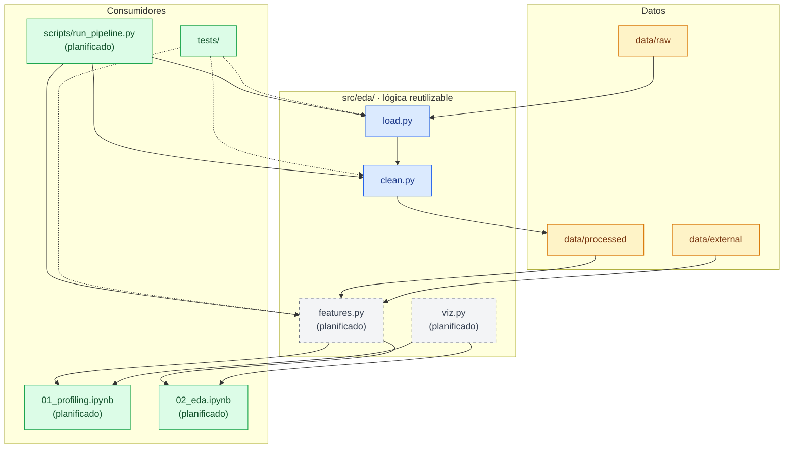

# 02 · Mapa de módulos

[← Volver al índice](../arquitectura.md)

> **En una frase:** la lógica vive en `src/eda/` y los notebooks, scripts y
> tests solo la consumen.
>
> ¿Es tu primera vez? Lee antes la [guía de lectura](00_guia_lectura.md).

## Para qué sirve

Este documento fija **dónde vive cada responsabilidad** y **quién puede llamar
a quién**. La regla de oro del proyecto es que la lógica reutilizable vive en
`src/eda/`; los notebooks y scripts solo la consumen.

## Diagrama



## Contrato de cada módulo

| Módulo | Estado | Responsabilidad | Funciones públicas | No debe hacer |
|---|---|---|---|---|
| `src/eda/load.py` | Implementado | Descargar con caché, leer el CSV y validar el esquema | `download_covid_data()`, `validate_schema()`, `load_covid_data()` | Limpiar, imputar ni calcular features |
| `src/eda/clean.py` | Implementado | Convertir fechas, quitar duplicados, guardar y auditar | `parse_date_column()`, `drop_invalid_dates()`, `remove_duplicates()`, `clean_covid_data()`, `save_processed_data()`, `audit_cleaning()`, `build_clean_dataset()` | Calcular ratios, medias móviles ni gráficos |
| `src/eda/features.py` | Planificado | Merge de población, ratios 100k, media móvil, log y segmentos | `merge_population()`, `add_rates()`, `add_moving_average()`, `add_segments()` | Leer CSV sin validar ni dibujar |
| `src/eda/viz.py` | Planificado | Funciones de gráfico reutilizables | Una función por tipo de gráfico, con `fig`/`ax` como retorno | Transformar datos ni decidir conclusiones |
| `scripts/run_pipeline.py` | Planificado | Orquestar `raw → processed` con un comando | `main()` | Reimplementar limpieza o features |
| `notebooks/*.ipynb` | Planificado | Narrar el análisis, llamar a `src/eda/` y mostrar resultados | — | Duplicar limpieza, importar otro notebook o versionar outputs |
| `tests/` | Implementado | Verificar `src/eda/` sin red y sin tocar datos crudos | — | Depender de internet o del CSV completo |

## Reglas de importación

```text
notebooks/*.ipynb   →  src.eda
scripts/*.py        →  src.eda
tests/*.py          →  src.eda
src/eda/*.py        →  stdlib + pandas/numpy (+ matplotlib/seaborn en viz)
```

- `clean.py` puede importar de `load.py` (`PROJECT_ROOT`, `load_covid_data`);
  es la única dependencia interna actual.
- `features.py` puede importar de `clean.py` y `load.py`, nunca al revés.
- `viz.py` no importa de `features.py` ni de `clean.py`: recibe un
  `DataFrame` ya preparado.
- Un notebook **no importa otro notebook**. Si comparten lógica, esa lógica
  sube a `src/eda/`.
- Un script **no importa de un notebook**. El notebook no es una librería.

## Límites del notebook

1. Ejecuta de arriba abajo, sin estado oculto.
2. Lleva Markdown explicativo antes de cada bloque de código.
3. No repite limpieza: llama a `src/eda/` y muestra el resultado.
4. No versiona outputs; se commitea sin salidas.
5. No inventa cifras: toda conclusión sale de una celda o figura.

## Tests por módulo

| Test | Estado | Qué cubre |
|---|---|---|
| `tests/test_load.py` | Implementado | Caché, esquema inválido, fallo de red y lectura con tipos |
| `tests/test_clean.py` | Implementado | Fechas imposibles, duplicados con/sin `dateModified`, no mutación y pipeline completo |
| `tests/test_smoke.py` | Implementado | Que los módulos principales se importan |
| `tests/test_features.py` | Planificado | Merge de población, ratios 100k y media móvil por estado |

## Estado actual

- Implementado: `load.py`, `clean.py` y sus tests.
- Planificado: `features.py`, `viz.py`, notebooks, pipeline de un comando y
  su test.

## Referencias

- `AGENTS.md` §4 y §6
- `src/eda/`
- `.agents/skills/eda-convenciones/`
- `openspec/changes/add-features-temporales/`
- `openspec/changes/add-pipeline-release/`
