# 03 · Modelo de datos

[← Volver al índice](../arquitectura.md)

> **En una frase:** una fila es un estado-día, y cada capa añade contexto sin
> cambiar esa clave.
>
> ¿Es tu primera vez? Lee antes la [guía de lectura](00_guia_lectura.md).

## Para qué sirve

Este documento describe las capas de datos, la granularidad, la clave y las
reglas de transformación. Sirve para no mezclar niveles (crudo, limpio,
enriquecido, features) y para justificar cada decisión sobre nulos,
negativos y ratios.

## Diagrama

```mermaid
flowchart LR
    subgraph RAW["1 · raw"]
        R1["date: entero YYYYMMDD"]
        R2["state · fips"]
        R3["acumulados + incrementos"]
    end

    subgraph CLEAN["2 · clean"]
        C1["date: datetime"]
        C2["clave (state, date) única"]
        C3["duplicados resueltos"]
        C4["auditoría de limpieza"]
    end

    subgraph ENRICH["3 · enriched"]
        E1["population por estado"]
        E2["casos por 100k"]
        E3["muertes por 100k"]
    end

    subgraph FEAT["4 · features"]
        F1["media móvil 7 días"]
        F2["log(casos)"]
        F3["segmento por ola / región"]
    end

    RAW --> CLEAN --> ENRICH --> FEAT
```



## Capas

| Capa | Dónde vive | Granularidad | Clave | Estado |
|---|---|---|---|---|
| `raw` | `data/raw/covid_tracking_states_daily.csv` | estado × día | `(state, date)` | Implementado |
| `clean` | `data/processed/covid_clean.csv` | estado × día | `(state, date)` única | Implementado |
| `enriched` | En memoria, generado por `features.py` | estado × día | `(state, date)` | Planificado |
| `features` | En memoria, generado por `features.py` | estado × día | `(state, date)` | Planificado |

## Grupos de columnas

| Grupo | Ejemplos | Tratamiento |
|---|---|---|
| Identificación | `state`, `fips` | Se leen como texto; `fips` no es numérico |
| Fecha | `date` | Entero `YYYYMMDD` → `datetime64[ns]` |
| Acumulados | `positive`, `death`, `totalTestResults` | Se conservan; no se suman entre estados sin normalizar |
| Incrementos | `positiveIncrease`, `deathIncrease`, `hospitalizedIncrease` | Pueden ser negativos por correcciones; se documentan |
| Hospitalización | `hospitalized*`, `icu*`, `ventilator*` | Varias con > 80 % de nulos; se excluyen y se justifica |
| Calidad | `dataQualityGrade` | Vacía al 100 % en la copia descargada; no se usa para deduplicar |

## Reglas del dominio

1. **Fecha:** `pd.to_datetime(df["date"].astype("string"), format="%Y%m%d",
   errors="coerce")`. Las fechas imposibles se eliminan y se cuentan.
2. **Clave:** `(state, date)` debe ser única. Si hay duplicados, se conserva
   el registro con `dateModified` más reciente; sin esa columna, el último.
3. **Nulos:** las columnas con más del 80 % de nulos se excluyen del análisis
   y se documentan en el diccionario.
4. **Negativos:** los incrementos negativos son correcciones de reporting.
   No se borran sin más: se documentan y, si se agregan, se explica el efecto.
5. **Merge de población:** `how="left"` y `validate="many_to_one"`; se
   comprueba que no se pierden estados ni se duplican filas.
6. **Ratios:** `positive_per_100k = positive / population * 100_000` y la
   versión de muertes con el mismo denominador.
7. **Media móvil:** siempre por estado:
   `groupby("state")["positiveIncrease"].transform(lambda s: s.rolling(7).mean())`.
   Los primeros 6 días de cada estado quedan como `NaN`.
8. **Log:** solo con una justificación explícita y ejes rotulados; se muestra
   también la serie original cuando aporte contexto.

## Cifras de referencia

Estas cifras corresponden a la copia descargada el 2026-11-06. Si cambia el
CSV, hay que regenerarlas y actualizar el diccionario:

| Métrica | Valor |
|---|---|
| Filas | 20.780 |
| Columnas | 56 |
| Fechas inválidas | 0 |
| Duplicados `(state, date)` | 0 |

## Comprobaciones rápidas

```python
import pandas as pd
from src.eda.load import load_covid_data
from src.eda.clean import clean_covid_data, audit_cleaning

raw = load_covid_data()
clean = clean_covid_data(raw)
print(audit_cleaning(raw, clean))

print("fechas nulas:", clean["date"].isna().sum())
print("duplicados:", clean.duplicated(subset=["state", "date"]).sum())
print("estados:", clean["state"].nunique())
```

## Referencias

- `docs/data_dictionary.md`
- `openspec/config.yaml` (reglas del dominio)
- `.agents/skills/covid-data-dictionary/`
- `src/eda/clean.py`
