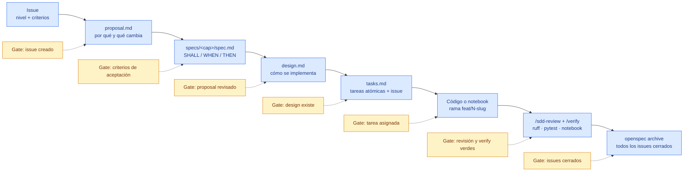

# 04 · Ciclo SDD y gates

[← Volver al índice](../arquitectura.md)

> **En una frase:** no se escribe código hasta que el issue, la spec, el
> design y las tareas existen.
>
> ¿Es tu primera vez? Lee antes la [guía de lectura](00_guia_lectura.md).

## Para qué sirve

Este documento explica el camino obligatorio de una tarea, desde el issue
hasta el archivo del change. Cada gate existe para evitar escribir código sin
spec, aprobar sin revisión o archivar con deuda abierta.

## Diagrama



## Gates

| Para escribir… | Requisito | Evidencia |
|---|---|---|
| `proposal.md` | Existe el issue en el Project | Enlace al issue y milestone `N1`/`N2`/`N3` |
| `specs/<cap>/spec.md` | El issue tiene criterios de aceptación | Checklist del issue |
| `design.md` | `proposal.md` revisado por una persona | Comentario o aprobación en el issue/PR |
| `tasks.md` | `design.md` existe | Enlace al design |
| Código o notebook | `tasks.md` existe y la tarea está asignada | Tarea con issue y rama |
| PR | `/sdd-review` pasado y `/verify` verde | CI verde y revisión |
| `openspec archive` | Todos los issues del change cerrados | Project en `Done` |

## Estados de una tarea

```text
Borrador → Aprobada (persona) → En construcción → En revisión → Archivada
```

| Estado | Quién lo mueve | Significado |
|---|---|---|
| Borrador | `spec-writer` o el agente principal | La tarea está escrita, pero no aprobada |
| Aprobada | Una persona | Se puede implementar |
| En construcción | `data-engineer`, `eda-analyst`, `viz-designer` o el principal | Hay rama y trabajo en curso |
| En revisión | `eda-reviewer` y `/verify` | Hay PR y falta veredicto |
| Archivada | El agente principal | Issues cerrados y change archivado |

## Artefactos de un change

```text
openspec/changes/<change>/
├── proposal.md        por qué y qué cambia
├── design.md          cómo se implementa
├── tasks.md           tareas atómicas con su issue
└── specs/<cap>/
    └── spec.md        requisitos y escenarios
```

## Comandos

```bash
npm run spec:list          # lista cambios y specs
npm run spec:validate      # valida todos los cambios
npm run spec:view          # vista interactiva
npx openspec archive <change>
```

## Errores comunes

- Escribir código sin `tasks.md` o con la tarea sin asignar.
- Aprobar tu propio `proposal.md` sin revisión humana.
- Archivar un change con issues abiertos.
- Mezclar niveles (`N1`/`N2`/`N3`) en la misma PR.
- Redactar una spec sin escenarios `WHEN/THEN` o sin caminos de error.
- Convertir una decisión de implementación en un requisito.

## Referencias

- `AGENTS.md` §5
- `.agents/skills/sdd-workflow/`
- `.agents/commands/` (`/sdd-spec`, `/sdd-plan`, `/sdd-tasks`, `/sdd-build`,
  `/sdd-review`, `/verify`)
- `openspec/`
