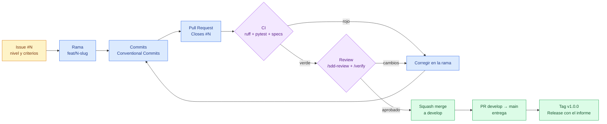

# 05 · Flujo Git y PR

[← Volver al índice](../arquitectura.md)

> **En una frase:** una tarea, una rama, una PR; la CI y la revisión deciden
> cuándo se integra.
>
> ¿Es tu primera vez? Lee antes la [guía de lectura](00_guia_lectura.md).

## Para qué sirve

Este documento explica cómo una tarea llega a `main` sin saltarse la
integración ni la CI. La regla base es **una tarea, una rama, una PR**.

## Diagrama



## Ramas

| Tipo | Patrón | Ejemplo |
|---|---|---|
| Feature | `feat/N-slug` | `feat/3-ingesta` |
| Fix | `fix/N-slug` | `fix/5-duplicados` |
| Documentación | `docs/N-slug` | `docs/arquitectura` |
| Tests | `test/N-slug` | `test/8-features` |

- `main`: entregas. Solo recibe PR desde `develop`.
- `develop`: integración.
- No se hace push directo a `main` ni a `develop`.
- Las ramas son cortas: se abren y se cierran con la tarea.

## Commits

Formato: Conventional Commits, con el tipo en inglés y el mensaje en español
(o inglés, pero consistente con el historial).

```text
feat(clean): añade limpieza básica de fechas y duplicados (#30)
docs(spec): vincula las tareas con los issues del backlog (#28)
fix(load): maneja la descarga vacía sin dejar un .part
test(features): cubre el merge de población
```

| Tipo | Uso |
|---|---|
| `feat` | Comportamiento nuevo |
| `fix` | Corrección de un fallo |
| `docs` | Documentación |
| `spec` | Cambios en `openspec/` |
| `test` | Tests |
| `ci` | CI |
| `chore` | Mantenimiento |
| `refactor` | Reestructuración sin cambio de comportamiento |

## CI

El workflow `.github/workflows/ci.yml` se lanza en PR a `develop`/`main` y en
push a `develop`.

| Job | Qué comprueba |
|---|---|
| `pr-title` | Que el título de la PR sigue Conventional Commits |
| `lint` | `ruff check .` |
| `tests` | `pytest -q` |
| `specs` | `npm run spec:validate` |
| `agent-infra` | `sync_agents.py --check` y `validate_agent_infra.py` |
| `notebooks` | Ejecuta los notebooks con `nbconvert`; si no hay, termina con aviso |

## Checklist de PR

- [ ] El notebook afectado ejecuta de arriba abajo sin errores.
- [ ] `ruff check .` limpio.
- [ ] `pytest -q` verde.
- [ ] `npm run spec:validate` verde.
- [ ] PR enlazada con `Closes #N`.
- [ ] Evidencia enlazada (commit, figura, tabla o notebook).
- [ ] Sin datos crudos, `.venv/` ni outputs de notebook en git.
- [ ] Entrada en `docs/ai-log.md` si se usó IA.

## Merge y release

1. La PR se revisa con `/sdd-review` y `/verify`.
2. Se hace **squash merge** a `develop`: un issue deja un commit limpio.
3. Cuando `develop` está estable, se abre una PR `develop → main`.
4. Sobre el merge en `main` se crea el tag `v1.0.0` y la release con el
   informe.

## Referencias

- `AGENTS.md` §8 y §10
- `.github/workflows/ci.yml`
- `.agents/skills/git-workflow-and-versioning/`
- `openspec/changes/add-pipeline-release/`
