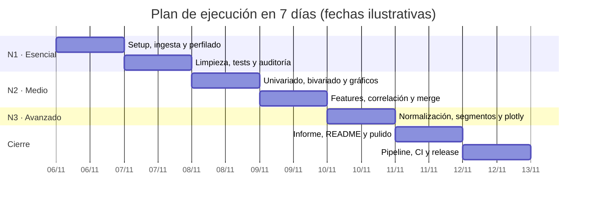

# 06 · Plan de 7 días y niveles

[← Volver al índice](../arquitectura.md)

> **En una frase:** N1 cierra el mínimo, N2 añade profundidad y N3 es el
> nivel objetivo.
>
> ¿Es tu primera vez? Lee antes la [guía de lectura](00_guia_lectura.md).

## Para qué sirve

Este documento reparte el trabajo en una semana y aclara qué se entrega cada
día. Los niveles se solapan a propósito: no se empieza el siguiente hasta
cerrar el anterior.

## Diagrama



> Las fechas son ilustrativas: el plan empieza cuando arranca la semana de
> trabajo. Lo importante es el orden y la duración, no el día del calendario.

## Día a día

| Día | Trabajo | Entregable | Validación | Issues |
|---|---|---|---|---|
| 1 | Setup del repo, OpenSpec, agentes/skills, ingesta y perfilado | `openspec/`, `load.py`, `01_profiling.ipynb` | `pytest tests/test_load.py`, notebook top-down | `N1-01`–`N1-04` |
| 2 | Limpieza básica y tests | `clean.py`, `test_clean.py`, `covid_clean.csv` | `pytest tests/test_clean.py`, auditoría revisada | `N1-04`, `N2-08` |
| 3 | Univariado, bivariado y primeras figuras | Secciones del notebook y 5–8 gráficos | Figuras con título, ejes y unidades | `N1-05`–`N1-08` |
| 4 | Features, correlación, tendencias y merge de población | `features.py`, heatmap, series, `population.csv` | Merge validado y media móvil por estado | `N2-04`–`N2-07`, `N3-02` |
| 5 | Normalización, outliers, segmentos y plotly | Análisis avanzado y gráfico interactivo | Ratios 100k, outliers justificados, segmentos claros | `N3-01`–`N3-06` |
| 6 | Informe ejecutivo, README y pulido del notebook | `reports/informe.md`, README final | Cada cifra trazable; 1–2 páginas | `N2-09`, `N2-10` |
| 7 | Pipeline, dashboard opcional, QA, CI y tag | `run_pipeline.py`, `v1.0.0` | `/verify` completo y release | `N3-07`, `N3-08` |

## Ruta crítica

```text
N1-01 setup → N1-02 ingesta → N1-04 limpieza → N1-03/N1-05 perfilado y preguntas
→ N1-06/N1-07 análisis → N2-05 features → N3-02 merge población
→ N3-04 media móvil → N2-09 informe → N3-07 pipeline → N3-08 release
```

Si se retrasa un eslabón, se recorta alcance del nivel siguiente antes que
saltarse la validación del actual.

## Reglas del plan

- **N1 cierra el mínimo entregable antes de empezar N2.**
- **N3 es el nivel objetivo**; el Experto (dashboard) es opcional.
- **Cada día el notebook debe ejecutar de arriba abajo.** No se arregla al
  final.
- **El día 7 incluye buffer** para QA, CI y release.
- **Una tarea, una rama, una PR.** No se mezclan niveles en la misma PR.

## Estado actual

| Bloque | Estado |
|---|---|
| Día 1 (setup, ingesta, perfilado) | Setup e ingesta hechos; notebook pendiente |
| Día 2 (limpieza y tests) | Limpieza básica y tests hechos |
| Días 3–7 | Pendientes |

## Referencias

- `docs/contexto_proyecto_eda.md` §4 y §9
- `openspec/changes/*/tasks.md`
- GitHub Project y milestones `N1 · Esencial`, `N2 · Medio`, `N3 · Avanzado`
