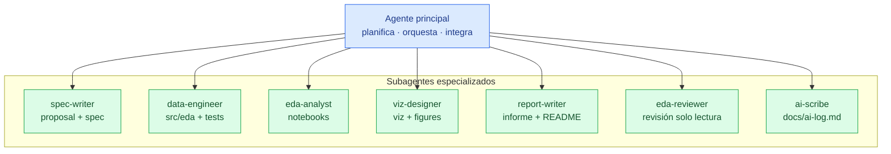

# 07 · Orquestación de agentes

[← Volver al índice](../arquitectura.md)

> **En una frase:** el agente principal orquesta y los subagentes no se llaman
> entre sí.
>
> ¿Es tu primera vez? Lee antes la [guía de lectura](00_guia_lectura.md).

## Para qué sirve

Este documento explica cómo se reparte el trabajo entre el agente principal y
los subagentes. La regla clave es que **un subagente no llama a otro**: si
necesita otro paso, devuelve el control al principal.

## Diagrama



## Subagentes

| Subagente | Escribe | Lee | Skills principales | Límite |
|---|---|---|---|---|
| `spec-writer` | `proposal.md`, `specs/<cap>/spec.md` | `AGENTS.md`, issue, `openspec/` | `sdd-workflow`, `covid-data-dictionary`, `eda-convenciones` | No aprueba ni implementa |
| `data-engineer` | `src/eda/`, `tests/` | `tasks.md`, `design.md`, `src/eda/` | `covid-data-dictionary`, `pandas-pro`, `test-driven-development` | No escribe notebooks ni informes |
| `eda-analyst` | `notebooks/`, `reports/figures/` | `tasks.md`, `src/eda/`, `data/processed/` | `statistical-analysis`, `data-analysis-jupyter`, `notebook-hygiene` | No limpia datos dentro del notebook |
| `viz-designer` | `src/eda/viz.py`, `reports/figures/` | `tasks.md`, `data/processed/` | `data-visualization`, `data-analysis-jupyter` | No cambia el análisis ni los datos |
| `report-writer` | `reports/informe.md`, `README.md` | notebook, figuras, issue | `executive-report-es`, `data-storytelling` | No toca código, datos ni notebooks |
| `eda-reviewer` | Nada (solo lectura) | todo el change o la PR | `notebook-hygiene`, `statistical-analysis`, `covid-data-dictionary` | No aprueba su propio trabajo |
| `ai-scribe` | `docs/ai-log.md` | lo que le pasa el principal | `trazabilidad-ia` | No edita entradas anteriores ni otros ficheros |

## Handoff por ficheros

El testigo se pasa por artefactos, no por llamadas entre subagentes:

```text
spec-writer      → proposal.md · spec.md
data-engineer    → src/eda/*.py · tests/*.py
eda-analyst      → notebooks/*.ipynb · reports/figures/*.png
viz-designer     → src/eda/viz.py · reports/figures/*.png
report-writer    → reports/informe.md · README.md
eda-reviewer     → veredicto (sin escribir)
ai-scribe        → docs/ai-log.md
```

El agente principal es el único que:

- decide el orden y el alcance;
- abre y cierra ramas;
- actualiza el Project;
- integra los resultados de varios subagentes en una PR.

## Reglas

1. **Un subagente no llama a otro.** Si hace falta otro paso, lo indica y
   vuelve al principal.
2. **Cada subagente tiene un límite de escritura.** `eda-reviewer` no escribe;
   `report-writer` no toca código.
3. **No se inventan datos.** Si falta un dato, se escribe `<<PENDIENTE>>` y se
   para.
4. **La revisión es independiente.** `eda-reviewer` no revisa trabajo que haya
   hecho él mismo.
5. **La bitácora se escribe al cerrar.** `ai-scribe` registra modelo, prompts,
   errores y decisiones.

## Referencias

- `AGENTS.md` §6 y §9
- `.agents/agents/`
- `.agents/skills/`
- `.agents/templates/ai-log-entry.md`
- `.opencode/agents/` (generado desde `.agents/agents/`)
